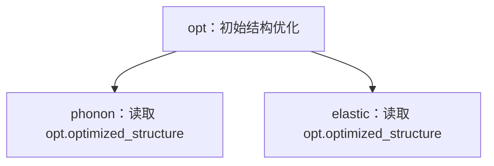

# 第 10 步：自动 DAG 规划

第 10 步的规划工具负责生成版本化计划，第 11 步通过同一 Agent 执行用户明确授权的计划。

## 执行、追问和独立复跑

以下命令在 WSL 终端打开本次验收工作区。新项目可替换 W 的值。

```bash
source /home/administrator/software/UniMatSim/.venv/bin/activate
cd /home/administrator/agent/2D-MatAgent
W="$PWD/.matagent/acceptance/step11/workspace"
python -m matagent --workspace "$W" --new
```

```text
查看计划 plan-20261123T162934Z-def4629e
执行这份计划
每个节点用了什么输入？
最终结构文件和原始结果在哪里？
```

终端同步等待计算。可从另一终端查询进度或指定节点。以下命令使用同一环境和 W 变量。

```bash
python -m matagent.execution status --workspace "$W" --id 20261123T163008Z-4e7904ec6b9d --node opt
python -m matagent.execution execute --workspace "$W" --id plan-20261123T162934Z-def4629e
python -m matagent --workspace "$W" --resume 20261123-162942-3ad8
```

普通执行复用同一版本已经登记的运行。需要另算一次时说“重新执行计划 plan-20261123T162934Z-def4629e”，或使用下列命令。重复提交同一个重跑请求编号会返回同一次运行。

```bash
python -m matagent.execution rerun --workspace "$W" --id plan-20261123T162934Z-def4629e --request-id my-second-run
```

每次运行写入 `runs/<run_id>/`。`preview.yaml` 是预览副本，`workflow.yaml` 和混合图的 `native/*.yaml` 使用运行目录内的实际路径。`events.jsonl` 记录状态变化，`artifacts/<node>/node.json` 记录输入绑定、参数、实际模型、产物及科学检查。`raw.json` 保存节点原始结果，`stdout.log` 和 `stderr.log` 保留可用日志。独立命令的最终参数在节点的 `invocation.json`，优化节点的 `outputs.structure_file` 给出最终结构文件。

本机按拓扑顺序执行。上游失败或前置条件不满足会阻断消费者，独立分支继续。未收敛优化保留结构、残余力和阈值。运行锁释放而状态仍为 running 时，查询返回 `interrupted_unverified`。重启后需要新的明确请求才能重新计算。后端源码变动使旧计划校验失败时，请先重新编译并查看新版本。

## 支持范围

当前目录有 **40 个可生成配置的能力入口**：9 个原生任务、22 个独立 CLI、5 个结构 API、3 个独立简化输运 API、1 个轨迹选帧适配器。另有 8 个上游占位/提示入口明确标为不可规划。规范名称、公开字段、类型、单位、默认表达式、证据和已知限制见 [完整覆盖表](capabilities.md) 与 [机器可读目录](capabilities.json)。

原生任务为 optimization、single_point、phonon、elastic、molecular_dynamics、eos、symmetry、bte、vasp_extract。独立接口包括数据导入/导出/转换/拆分/统计、对称性分析与筛选、模块比较、报告、模型 benchmark 和五种已实现的微调后端。服务管理、下载和全局配置写入不属于计算节点；模型发现和选择继续使用第 8 步工具。

## 启动与自然语言使用

```bash
source /home/administrator/software/UniMatSim/.venv/bin/activate
cd /home/administrator/agent/2D-MatAgent
python -m matagent --new
```

先选择或恢复已有结构、势模型，再逐句输入：

```text
用项目已有原型建立一个默认 MoS₂ 单层。
用刚才的结构和项目默认势模型，创建工作流：先二维优化，固定晶胞，力阈值0.02 eV/Å，最多100步；再分别做声子和弹性。只规划，不运行。
删除刚才工作流的声子分支，把优化的力阈值改成0.015，其他不变。
给我看这份工作流，每个任务用了哪个结构和权重？
```

其他请求：

- “创建另一份工作流：先单点，再做初始温度300 K、1 fs时间步长、10步的MD；EOS独立读取初始结构，9个采样点，关闭内部优化。”
- “提取 /你的/vasp目录 的结果，只生成配置，不需要势模型。”
- “创建 MatterSim 微调计划，CPU，1个epoch；我还没提供训练集，先说明缺项。”
- “列出你能规划的任务，说明当前 MD 能设置哪些参数。”

未知结构或模型不会被另一个对象替换。多个候选时要求指定编号。参数含糊时询问明确数值。缺少必要输入可保存 needs_clarification 计划；补齐时用 update_workflow 创建新版本。

## 数据绑定与失败传播

顺序边 after、输入绑定 inputs、前置条件 preconditions 分开保存。优化后的分支必须显式绑定 optimized_structure，并默认要求 optimization_info.converged=true。

```json
{
  "id": "phonon",
  "capability": "phonon",
  "inputs": {
    "structure": {
      "node": "opt",
      "output": "optimized_structure",
      "type": "structure"
    }
  }
}
```



代码由同一份计划生成图、YAML 和节点表。两个分支分别获得副本。缺失指定输出、上游失败/跳过、条件不满足会阻断，不能回退初始结构。普通顺序边不虚构数据传递，也不把“优化收敛”施加到无关数据节点。

对称性 screening_passed 条件需显式声明。UniMatSim 在弹性前驱不稳定时跳过声子属于原生软件策略，不能解释成普适物理定律。MD 的 structure 输出是输入结构；取末帧需 trajectory.select_frame，并显式给出参考晶胞/PBC。

EOS 的内部 relax_structure 默认 true；显式使用优化结果时，未另行要求的内部优化设为 false，并记录来源。弹性应变操作与初始结构优化的晶胞自由度分开配置。

## 计划、YAML 和路径

计划目录 `.matagent/plans/<plan_id>/` 保存：

| 文件 | 内容 |
|---|---|
| plan.json | schema_version=3，kind=workflow_dag，节点、前驱、绑定、条件、模型、参数来源、父版本、输入/源码哈希 |
| workflow.yaml | 纯原生图为 UniMatSim 配置；混合/独立图为 matagent-workflow-v1 清单 |
| native/*.yaml | 混合图中的原生节点配置；跨节点输入需未来 Agent 执行适配器先解析 |
| native/*-training.json | 用户结构化 training_config 编译出的额外训练配置 |
| inputs/*.vasp | 登记结构导出的本计划输入；源 JSON、来源和 PBC 保留引用 |
| dag.mmd | 由计划生成的 Mermaid |
| nodes.json | 完整节点参数与输入输出表 |
| validation.json | 图、参数/YAML、原生解析、环境/输入缺项及执行状态 |

原结构、权重不复制覆盖。输入文件和数据目录保存内容清单/哈希；目录指纹排除 Agent 自身 `.matagent` 记录，避免保存计划引发自污染。生成路径均位于本计划目录，各节点有独立规划输出目录 `artifacts/<node_id>`，预览不会创建该计算输出目录。

结构与权重路径使用 WSL 绝对路径，含空格和中文由 YAML 库序列化。Windows 路径需用户提供对应 WSL 路径。POSCAR 不编码 PBC；计划分别记录来源 PBC、导出后读入约定以及任务二维参数。

独立接口使用固定 argv 或固定 Python callback。单侧 Typer 布尔选项不能无损表达 false 时，改用同一公开函数的固定 callback 并显式传参；不丢弃用户值。语言模型无法提供任意 shell、Python 或原始 YAML。

## 工具和代码入口

| 入口 | 作用 |
|---|---|
| list_capabilities / inspect_capability | 发现能力、参数、默认值、输入输出与源码证据 |
| preview_workflow | 结构化 nodes、共享结构/模型/设备及 execution 描述生成计划 |
| update_workflow | patches、add_nodes、remove_nodes 新建版本；删除悬空输入会被拒绝 |
| inspect_plan / validate_plan | 同时支持旧单任务和新 DAG；重读文件与证据 |
| WorkflowStore.normalize / save_workflow | 不依赖语言模型的 Python 规划入口 |
| matagent.plan_cli validate / compile | 已保存计划的独立校验和重编译 |

节点参数白名单来自实际源码。optimization_monitor 使用上游纯配置检查；训练额外参数按所选后端识别并编译 JSON。完整深层科学约束的未验证部分已列入能力文档，不以配置解析替代计算验收。

## 模型、设备与环境

本地权重使用已有登记和加载证据，不重复加载。经典势、内置模型和本地文件分别记录。经典势/内置模型无本机证据时可生成待验证计划；缺少证据不等于后端不支持。对称性、数据提取等不要求势模型。

CPU 是规划默认。其他设备保留请求并记录缺项，不静默切回 CPU。原生 direct/remote、material/task、parallel 和进程隔离按真实 CLI 约束记录；远程没有连通性或鉴权验收，凭据只在未来执行环境读取。OpenCSP 远程和不兼容隔离组合被拒绝。

校验状态：

- config_validated：本次配置和已实施检查通过；仍没有执行。
- config_validated_pending_environment：配置通过，加载、设备、依赖或独立计算验证仍缺。
- needs_clarification：必要输入/模型/参数缺失；不能作为完整配置使用。
- blocked：文件、哈希、图、字段、参数或解析校验失败。

修改不会覆盖旧 YAML。输入/权重/后端源码发生变化时，旧计划失效；须显式要求 update_workflow(recompile=true) 创建新版本，不会静默修改旧证据。第 9 步旧格式保留原工具和编译入口，但同样遵守源码证据失效规则。

## 可复制的验收产物命令

在上述 WSL 环境中运行，读取本次真实语言模型验收产物：

```bash
matagent --workspace '/home/administrator/agent/2D-MatAgent/.matagent/acceptance/step10/live-71b95aa3fa/workspace' --resume 20261123-104113-5f6f '给我看这份工作流的 YAML'
python -m matagent.plan_cli validate --workspace '/home/administrator/agent/2D-MatAgent/.matagent/acceptance/step10/live-71b95aa3fa/workspace' --plan-id plan-20261123T104145Z-74e75a2e
python -m matagent.plan_cli compile --workspace '/home/administrator/agent/2D-MatAgent/.matagent/acceptance/step10/live-71b95aa3fa/workspace' --plan-id plan-20261123T104145Z-74e75a2e --output reviewed-workflow.yaml
```

compile 输出必须是工作区内尚不存在的 YAML 文件。此命令不会执行工作流。对混合图重新生成的是 Agent 清单，关联 native 文件仍引用原计划目录。

## 验证结果与限制

- 完整离线回归：109 项，102 通过、7 项可选验收跳过。
- 上游兼容性：2 项原有模拟任务测试通过，验证失败传播和非收敛任务的旧行为。
- 真实 DeepSeek CLI：分支规划、修改、恢复、单点/MD/EOS、无势模型 VASP 计划及微调缺项澄清通过。微调缺项可直接提问，不要求为此伪造训练集。
- 独立编译：真实计划重新生成的 YAML 与原始文件逐字、语义一致。
- 原生任务、独立接口配置和参数检查使用真实源码/解析器；数据传递测试使用模拟任务返回值。势证据复用已有真实 MatterSim 记录，其他本地后端的测试夹具明确标为 synthetic。
- 新材料计算 0 次、新势模型加载 0 次、训练 0 次。

本机报告：`.matagent/acceptance/step10/delivery.json`、`report.json`、`offline-tests.txt`、`live-tests.txt`、`upstream-tests.txt` 和 `compile.txt`。实际对话及每次工具调用在 report.json 与 live-* 会话副本中。

以上为第 10 步配置验收记录。运行适配范围和实测证据见 [执行覆盖表](execution.md)。
